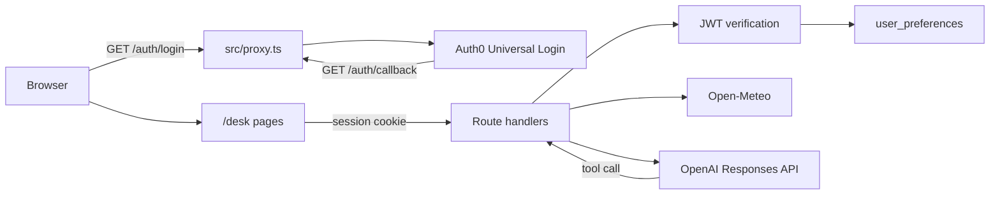

# SecureDesk architecture

SecureDesk is a Next.js server application. The browser holds an encrypted Auth0 session cookie. Preferences, weather calls, OpenAI calls, and the database stay on the server.

## Authentication

`src/lib/auth0.ts` constructs the official `Auth0Client` from `@auth0/nextjs-auth0/server`.

`src/proxy.ts` calls `auth0.middleware(request)`. That mounts:

- `/auth/login`
- `/auth/logout`
- `/auth/callback`
- `/auth/profile`
- `/auth/backchannel-logout`

The access-token endpoint is turned off with `enableAccessTokenEndpoint: false`.

`/desk` is also checked in the proxy and again in `src/app/desk/layout.tsx` with `auth0.getSession()`. A missing session redirects to `/auth/login?returnTo=/desk`. The `returnTo` value is a relative path.

API routes call `auth0.withApiAuthRequired()`, then `auth0.getAccessToken()`, then `jose` `jwtVerify` against `https://AUTH0_DOMAIN/.well-known/jwks.json`. Verification requires:

- signature via the Auth0 JWKS
- issuer `https://AUTH0_DOMAIN/`
- audience `AUTH0_AUDIENCE` when the access token is a JWT, or `AUTH0_CLIENT_ID` when Auth0 issued an opaque access token and the ID token is verified instead
- algorithm RS256
- a `sub` claim equal to `session.user.sub`

The subject written to `user_preferences.auth0_subject` is that validated `sub`. Handlers do not read a user id from the query string or body. Preference updates use a strict Zod object, so an extra `auth0_subject` field is a 400.

## Preferences

`user_preferences` is defined in `src/lib/db/schema.ts` and created by `drizzle/0000_user_preferences.sql`.

| Column | Purpose |
| --- | --- |
| `id` | Row id |
| `auth0_subject` | Unique Auth0 subject |
| `preferred_city` | City sent to Open-Meteo geocoding |
| `preferred_country` | ISO 3166-1 alpha-2 filter |
| `preferred_timezone` | IANA timezone for working hours |
| `working_hours_start` | `HH:MM` |
| `working_hours_end` | `HH:MM` |
| `temperature_unit` | `celsius` or `fahrenheit` |
| `created_at` | Insert time |
| `updated_at` | Last update |

`GET /api/me` returns the signed-in profile. `GET /api/me/preferences` and `PATCH /api/me/preferences` read and update only the row for the authenticated subject.

## Weather

`src/lib/weather/open-meteo.ts` resolves the saved city through `https://geocoding-api.open-meteo.com/v1/search`, then requests current conditions from `https://api.open-meteo.com/v1/forecast`.

Both calls use `AbortSignal.timeout`. Timeouts become HTTP 504. Non-OK responses and unusable payloads become HTTP 502. An unknown city becomes HTTP 404.

`src/lib/weather/suitability.ts` decides whether the current local time is inside working hours and whether the temperature, wind, and weather code are reasonable for an outdoor meeting. The assistant is instructed to use those fields.

## Assistant

`POST /api/assistant` accepts only `user` and `assistant` messages. The system instructions are set on the server.

The Responses API receives two strict tools with empty parameter objects:

- `get_user_preferences`
- `get_current_weather`

Tool execution is in `src/lib/ai/tools.ts`. Arguments that name a user or a city are ignored. Both tools close over the authenticated subject and call the same preference and weather services as the HTTP API.

The OpenAI client is created in `src/lib/ai/openai.ts` with `OPENAI_API_KEY`. That variable is not prefixed with `NEXT_PUBLIC_`.

## Request protection

- Zod validates preference and chat bodies.
- `PATCH` and `POST` reject a mismatched `Origin` host.
- A sliding window limiter keys limits by client and by subject.
- `src/lib/security/redact.ts` strips credentials before error logs.
- Session cookie `httpOnly` is forced by the Auth0 SDK. `sameSite` defaults to `lax`. `secure` is enabled in production.
- API responses send `Cache-Control: private, no-store`.
- Security headers are set in `next.config.ts`.

The rate limiter is process memory. It is the right control for one Node process and should be replaced with a shared store if the app runs on more than one instance.
